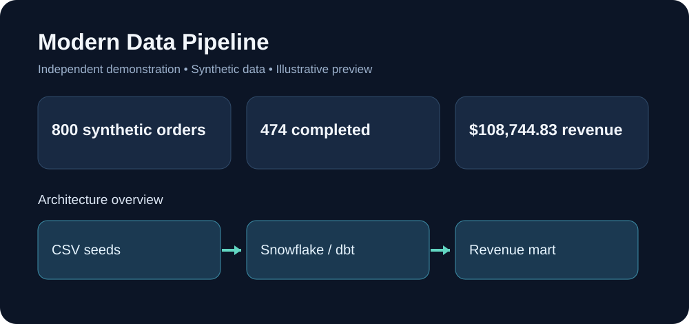
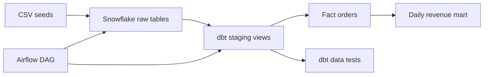

# Modern data pipeline | dbt · Snowflake · Airflow

A **synthetic commerce analytics pipeline** that transforms raw order data into modeled and tested revenue marts. This is an independent learning project, not a production or employer deployment.



## Architecture



## Quickstart: local check

```bash
python local_demo.py
```

This SQLite-based demo reproduces the revenue aggregation and checks customer links and allowed statuses. It **does not** execute Snowflake, dbt or Airflow.

## Snowflake and dbt setup

1. Install `pip install -r requirements.txt`.
2. Copy `profiles.example.yml` to `~/.dbt/profiles.yml` and set the required `SNOWFLAKE_*` environment variables. **Do not commit credentials.**
3. Run `dbt debug && dbt seed && dbt build`.
4. Configure Airflow 2.10 separately, place `dags/portfolio_pipeline.py` in its DAG folder and set `DBT_PROJECT_DIR` for the task runtime.

## Demonstration results

A reproducible synthetic dataset of 120 customers and 800 orders is included in `seeds/`. Run the local script for totals by region and integrity-check status.

## Scope and limitations

The included Airflow DAG and Snowflake profile are deployment starters. Cloud execution, production-grade incremental loading, secrets storage, and alerting have **not** been independently deployed or validated. All screenshots are illustrative visualizations of the synthetic demonstration.
