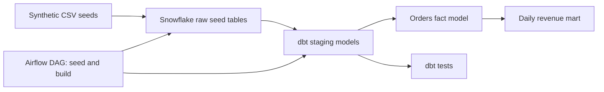

# Modern Data Pipeline
**Snowflake · dbt · Airflow · SQL · Python** | Independent portfolio project

Build a reproducible commerce-data pipeline: ingest synthetic customers/orders, clean them with dbt staging models, join a fact table, and aggregate completed-order revenue by date and region.


## Why this project?
Analytics teams need trustworthy order-level data and consistent daily revenue definitions. This demo separates raw inputs, transformation logic, and quality checks so that reported totals are traceable.

## Design


## Reproduce the local result
Python 3.10+; no cloud credentials or dependencies required for the **local SQLite demonstration**.

```bash
python local_demo.py
```

The script checks customer references and allowed statuses and computes region-level completed-order revenue.

| Synthetic input / output | Result |
|---|---:|
| Customers | 120 |
| Orders | 800 |
| Completed orders | 474 |
| Completed-order revenue | **$108,744.83** |
| Missing customer references | 0 |

The revenue figure is derived solely from the committed synthetic dataset (`seeds/raw_orders.csv`).

## How to run dbt on Snowflake
1. `pip install -r requirements.txt`.
2. Copy `profiles.example.yml` to `~/.dbt/profiles.yml`.
3. Supply the `SNOWFLAKE_*` environment variables in your shell or a secret manager; **never commit secrets**.
4. Run `dbt debug && dbt seed && dbt build`.
5. Optionally provision Airflow separately and use `dags/portfolio_pipeline.py` with `DBT_PROJECT_DIR` pointing to the project.

## Where to look
- `seeds/` — reproducible raw input CSVs
- `models/staging/` — typed staging views
- `models/marts/` — order fact and daily revenue mart
- `models/schema.yml` — quality tests
- `dags/` — orchestration example
- `local_demo.py` — zero-cost local validation

**Scope:** dbt/Snowflake/Airflow assets are starter implementations, not a verified cloud deployment. The SVG is a labeled *illustrative overview*, not a screenshot of a running Snowflake or Airflow environment. No employer data is included.
